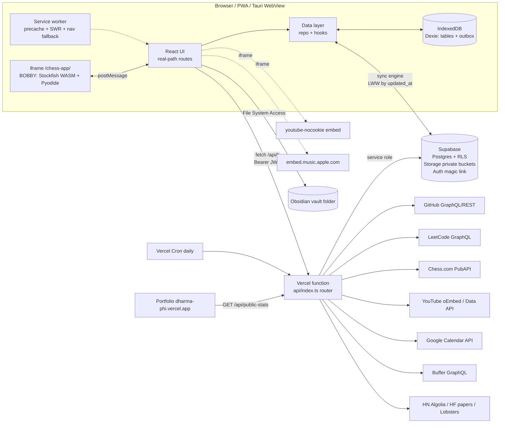

# ONE: Build Plan

Status legend: `[ ]` todo, `[x]` done, `[~]` done with a mock/placeholder (see NEEDS-FROM-DHARMA.md).
Written 2026-11-27 after reading all of `docs/brief/`, the three source repos and heyalok.com.

---

## 1. Summary
ONE is Dharma's single, distraction-free "lock-in" app: Home + four sections (CAREER, MIND, BODY, PERSONA) + Settings.
It is a Vite + React + TypeScript PWA with real-path routing, installable as 5 scoped apps from one origin, later wrapped by Tauri.
Data is local-first (IndexedDB via Dexie) and syncs to one Supabase project (Postgres + RLS + Storage) owned by one user.
Third-party calls that need secrets, custom headers or CORS go through **one** Vercel serverless function (a router).
No AI, no feeds, no infinite scroll, no notifications except a Google Calendar reminder; pure-black dark theme by default.

---

## 2. Findings

### 2.1 Source repos
**Cubicle** (`site/`, MIT): Vite 5, React 18, plain CSS, hash routing, localStorage stores (`store.ts`, `study.ts`), postMessage YouTube controller (`player.ts`), Vercel functions `chat.js` (AI, **dropped**), `news.js` (HN Algolia + HF daily papers + Lobsters, no key), `video.js` (oEmbed + watch-page scrape for duration). Data: `public/data/videos.json` (2 MB, ~2,000 videos with section/node/channel/duration), `taxonomy.json` (12 sections, ~100 nodes).
- Reuse: `player.ts` (postMessage API, ported to TS module in `src/modules/library/player.ts`), the 3/7/30/90 spaced-review logic from `study.ts`, `news.js` source fetchers (ported into the API router), `video.js` oEmbed logic, `taxonomy.json` + `videos.json` (imported into the CAREER Library **Inbox**, `approved=false`), command-palette idea, focus/Pomodoro idea.
- Delete/not ported: `ai.ts`, `aipage.tsx`, `aipanel.tsx`, `aistate.ts`, `api/chat.js`, `api/_providers.js`, `related.ts` (recommendations), `scroll.tsx`/`proscroll.ts` (shorts feed = infinite scroll), the Python `05b_llm_label.py` (LLM). The pipeline stays optional; not required for ONE.

**BOBBY** (`site/` GPL-3.0, `py/` Python core, `data/`): Vite 5 React 18 app, hash router, Dexie DB, Stockfish 18 **lite single-thread** WASM in a worker (`bridge/engine.ts`) and python-chess in Pyodide (`bridge/py.worker.ts`). Its `prepare-assets.mjs` copies Pyodide + Stockfish into `public/` and downloads python-chess with `python3 -m pip` (python3 is **not** installed on Dharma's machine; the worker falls back to micropip at runtime).
- **COOP/COEP finding:** BOBBY already uses the single-threaded lite build, which needs **no** cross-origin isolation. So ONE sends **no COOP/COEP headers at all**, and YouTube/Apple Music iframes keep working. Risk closed.
- Integration: copy BOBBY's `site/`, `py/bobby`, `data/` into `packages/chess` unchanged except (a) a ONE theme override stylesheet (pure black, ONE fonts, MIND accent), (b) `base: "/chess-app/"`, (c) a node-only python-chess fetch (no python3 needed), (d) a small `postMessage` bridge to receive a PGN to review and to report "puzzle solved / game finished" events to ONE. Its build output is copied into `apps/web/dist/chess-app/` and loaded in a same-origin `<iframe>` only on `/mind/chess`. That gives total CSS/global isolation and guarantees the chess weight (Pyodide ~10 MB) never touches other routes.
- BOBBY's Scroll video list (`data/cubicle/`) seeds the MIND Library Inbox (chess topic, `approved=false`).

**DHARMA** (`portfolio/`): Next.js 14 App Router, Tailwind 3, tokens `--bg/--fg/--muted/--accent` as RGB channels, paper `#FAFAF9` / ink `#0A0A0A` / accent `#FF4F00` (dark `#FF6A3D`), Inter + Geist Mono + Inter Tight, `Section` component with `label`, server components with `revalidate = 300`, an existing `Now` section fed by Supabase. Brief's description matches the code.
- Plan: add `components/LiveFromOne.tsx` (client component, fetch on mount, hide on failure), render it inside the `Now` section. Branch `feat/live-from-one`.

### 2.2 Design analysis
See `docs/DESIGN-ANALYSIS.md`. Tokens in the brief are exact matches. Dominant radius is 2px (not .625rem). Body weight 500 everywhere. Signature easing `cubic-bezier(.22,1,.36,1)`. Contribution cells settle 220 ms with +2 ms stagger. Content column on desktop is only ~660px of 1440 (the weakness ONE fixes).

### 2.3 Integration checks (2026-11-27)
| Integration | Finding | Deviation from brief |
|---|---|---|
| Vercel Hobby | Cron: up to 100 jobs but **at most once per day**, ±59 min precision. **Max 12 serverless functions per deployment** (each top-level `api/*` file is one function). | Use **one** function `api/index.ts` with an internal router (rewrite `/api/(.*)` → `/api/index`). One daily cron (`/api/cron/daily`, 00:30 UTC = 06:00 IST) for snapshots; everything else refreshes on demand with a TTL. |
| Supabase Free | Pauses after ~1 week of low activity; 2 active free projects; 500 MB DB per project; 1 GB storage; paused projects restorable for 90 days. | None. Daily cron also keeps the project warm. |
| Google OAuth | Testing-mode external apps get refresh tokens that **expire after 7 days**. Calendar scopes are "sensitive": production without verification shows an "unverified app" screen but works for a personal app (100-user cap). | Recommend: keep Dharma as the only user, **switch the app to "In production"** and click through the unverified warning once; tokens then persist. Until then, ONE shows a "Reconnect Google" prompt when refresh fails. Scopes: `calendar.app.created` (create/manage the "ONE" calendar and its events) + `calendar.events.readonly` + `calendar.calendarlist.readonly`. |
| Buffer | Legacy v1 REST API is closed to new apps. New **GraphQL API** at `https://api.buffer.com` with a **personal API key** (Bearer) from account settings; `createPost` mutation (text, channelId, mode e.g. `addToQueue`/`customScheduled` + `dueAt`, `saveToDraft`). OAuth for third-party apps not generally open. | Use the personal API key as `BUFFER_ACCESS_TOKEN` (server only). Query `channels` to map X/LinkedIn channel ids. Fallbacks always on. Exact mutation shape re-verified against `developers.buffer.com` when the key is provided (marked in NEEDS). |
| YouTube | Data API v3: 10,000 units/day, `videos.list` = 1 unit. oEmbed needs no key. Frame images under `i.ytimg.com/vi/<id>/`: verified `1/2/3.jpg` (120×90), `mq1-3` (320×180), `hq1-3` (480×360), `sd1-3`, `maxres1-3` all return 200 for 4 sampled videos; missing ones return 404. | Cards use `mq2.jpg` (small, ~8 KB), player poster uses `hq2.jpg`; `onerror` → next candidate → generated accent card. Frame picker (1/2/3) per video. |
| Chess.com PubAPI | Unchanged: `/pub/player/{u}/stats`, `/games/archives`, monthly archive JSON with PGN. No key; descriptive User-Agent with contact; ETag/Last-Modified supported; data refreshed periodically. | None. |
| LeetCode | Unofficial `POST https://leetcode.com/graphql`, query `matchedUser(username){ submitStatsGlobal { acSubmissionNum { difficulty count } } profile { ranking } }`. Needs `Referer: https://leetcode.com`. May break. | None; stale-tag fallback. |
| GitHub | GraphQL `user(login){ contributionsCollection{ contributionCalendar{ totalContributions weeks{ contributionDays{ date contributionCount } } } } }`; REST `/users/{u}/events` for PushEvents. Fine-grained PAT, read-only public data. | None. |
| Apple Music | `https://embed.music.apple.com/{storefront}/{album|playlist}/...` iframe; previews without sign-in, full tracks when signed in inside the widget. MusicKit needs paid dev account (not used). | Sign-in persistence in installed PWAs/WebView2 must be tested manually by Dharma; "Open in Apple Music" fallback always shown. |
| Fonts | Geist Pixel (incl. Square) and Geist Mono: OFL 1.1; Pixelify Sans: OFL 1.1; Inter: OFL 1.1. All on Fontsource. | None. |
| Toolchain | Latest npm majors (React 19, Vite 8, TS 7, ESLint 10) are newer than BOBBY's stack. | Pin the proven stack: React 18.3, Vite 6, Vitest 3, TS 5.9, ESLint 9, react-router-dom 6. React 18 is required by `react-chessboard@4` anyway. Upgrade later as one task. |
| Rust | Not installed on the dev machine. | Tauri phase installs `rustup` (free). If the MSVC build tools are missing, the desktop build is logged as a NEEDS item and everything else continues. |

### 2.4 Other deviations
- **Licence:** ONE includes BOBBY (GPL-3.0) → ONE is **GPL-3.0-only** by default. Cubicle's MIT notice is kept in `THIRD_PARTY_NOTICES.md`. Asked in NEEDS.
- **Flashcards:** SM-2 (documented, simple, fully testable) instead of FSRS. FSRS can replace it later behind the same `schedule()` interface.
- **Local mode:** when `VITE_SUPABASE_URL` is not set, ONE runs fully offline in "local mode" (IndexedDB only, no auth). This is the mock behind an env flag that lets everything be built and used before Dharma creates the Supabase project.
- **Server function signature:** classic Node `(req, res)` handler, plus a Vite dev middleware that mounts the same router, so `pnpm dev` serves `/api/*` without the Vercel CLI.

---

## 3. Architecture

### 3.1 Diagram


### 3.2 Folder structure
```
ONE/
├─ apps/
│  ├─ web/                        # the ONE PWA (Vercel root directory)
│  │  ├─ index.html               # master app entry  (manifest /manifest.webmanifest)
│  │  ├─ career/index.html        # ONE Career entry  (manifest /career/manifest.webmanifest)
│  │  ├─ mind/index.html  body/index.html  persona/index.html
│  │  ├─ api/index.ts             # the ONLY serverless function (router)
│  │  ├─ server/                  # server-only code imported by api/index.ts
│  │  │  ├─ router.ts  http.ts  auth.ts  crypto.ts  supabaseAdmin.ts  cache.ts
│  │  │  └─ routes/ news.ts video.ts linkTitle.ts chesscom.ts leetcode.ts github.ts
│  │  │            google.ts buffer.ts publicStats.ts cron.ts health.ts
│  │  ├─ public/                  # manifests, icons, fonts are bundled; robots.txt
│  │  ├─ scripts/                 # build helpers (icons, copy chess-app, seed data packs)
│  │  ├─ src/
│  │  │  ├─ main.tsx  App.tsx  routes.tsx  scope.ts
│  │  │  ├─ styles/ tokens.css base.css motion.css layout.css
│  │  │  ├─ ui/                   # design system components (+ index.ts)
│  │  │  ├─ art/                  # original SVG banner scenes
│  │  │  ├─ data/                 # db.ts (Dexie schema), repo.ts, sync.ts, supabase.ts, auth.ts, ids.ts, dates.ts
│  │  │  ├─ domain/               # pure logic: xp, levels, streaks, grade, done-rules, sm2, review, sgpa,
│  │  │  │                        #   progression, thumbs, queue, ladder, rotation, lagging, quotes, prompts
│  │  │  ├─ modules/              # shared modules: library, analytics, path, focus, palette, music, review, obsidian, xp
│  │  │  ├─ pages/                # home, career/*, mind/*, body/*, persona/*, settings, ui (style guide), login
│  │  │  ├─ seed/                 # seed content from brief 17 (TS) + achievements + quotes + prompts
│  │  │  └─ test/                 # test setup
│  │  ├─ e2e/                     # Playwright specs
│  │  ├─ vite.config.ts  vitest.config.ts  playwright.config.ts  vercel.json  tsconfig*.json
│  ├─ desktop/                    # Tauri 2 wrapper (src-tauri/)
├─ packages/
│  └─ chess/                      # BOBBY (GPL-3.0), built to /chess-app/
├─ supabase/
│  ├─ migrations/0001_init.sql …  # tables, indexes, RLS, views, storage buckets
│  ├─ seed.sql                    # minimal SQL seed (non-personal reference data)
│  └─ config.toml
├─ scripts/
│  ├─ import/notion/              # Notion export importers (+ input/ gitignored)
│  └─ seed/                       # TS seeding of brief-17 content into Supabase
├─ docs/                          # brief, PLAN, PROGRESS, DECISIONS, NEEDS, SCHEMA, TESTING, USER-GUIDE
├─ .github/workflows/ci.yml
├─ package.json  pnpm-workspace.yaml  tsconfig.base.json  eslint.config.js  .prettierrc  .env.example
├─ LICENSE (GPL-3.0)  THIRD_PARTY_NOTICES.md  README.md
└─ _ref/                          # cloned source repos (gitignored)
```
Decision (DECISIONS.md): the UI library lives in `apps/web/src/ui` instead of a separate `packages/ui` package. Only one app consumes it (the desktop app loads the same web build), so a package adds build plumbing with no benefit.

### 3.3 Routing
`react-router-dom` 6, `BrowserRouter`, real paths:
```
/                         Home
/career  /career/:tab     path|library|practice|build|news|reading|notes|college|analytics
/career/library/watch/:videoId
/career/college/:semesterId/:subjectId
/mind  /mind/:tab         chess|meditate|library|focus|memory|reading|analytics|cube|math|palace
/body  /body/:tab         workout|schedule|weigh-in|diet|water|progress|library|analytics
/persona  /persona/:tab   speak|daily|connections|compose|ideas|x-follows|intel|presence|library|analytics
/settings  /settings/:tab profile|appearance|integrations|public|modules|targets|data|account
/review/week              Sunday weekly review
/login  /auth/callback
/ui                       hidden living style guide
```
Section routes are code-split with `React.lazy`. The chess iframe and the recorder load only on their tabs.

### 3.4 State management
- **Source of truth on device:** Dexie (IndexedDB) tables that mirror the Postgres tables 1:1 (same names, same columns, ids are client-generated UUID v4).
- **Reads:** `useLiveQuery` hooks in `src/data/hooks.ts` (re-render on any write).
- **Writes:** `repo.put/patch/remove(table, row)` → stamps `updated_at`, `user_id`, writes the row and appends an `outbox` entry in one Dexie transaction.
- **UI-only state** (palette open, focus running, theme) in a tiny `useSyncExternalStore` store (`src/data/ui.ts`), with theme mirrored to `settings` and `localStorage` for first paint.

### 3.5 Offline / sync
- `sync.ts` runs on: app start, `online` event, every 60 s while visible, after each write (debounced 1.5 s).
- **Push:** drain `outbox` in order, `upsert` per table in batches of 100; soft deletes (`deleted_at`) so deletes sync. On success remove outbox entries.
- **Pull:** per table `select * where updated_at > last_pulled_at[table]` (paged 1,000); write rows where remote `updated_at` > local `updated_at` (**last-write-wins**). Conflicts (local row dirty in outbox and remote newer) are logged to a `sync_log` Dexie table and shown in Settings › Data.
- **Storage blobs** (recordings, photos): saved to Dexie `blobs` first, uploaded to private buckets on sync; download on demand via signed URLs.
- **Local mode** (no Supabase env): sync is a no-op, auth is skipped, a "Local mode" chip shows in Settings.

### 3.6 Five PWAs
- Vite multi-page build with 5 HTML entries. Each HTML has `<meta name="one-scope" content="career">` and links its own manifest + apple-touch-icon. All share one JS bundle.
- `scope.ts` reads the meta tag: in a section app, the rail/dock shows only that section + Settings, and links to other sections open the master app in a new window (`target="_blank"` to `/`).
- One root service worker `/sw.js` (scope `/`, built with Workbox via `vite-plugin-pwa` `injectManifest`): precache shell + fonts; navigation requests under `/career/` → `career/index.html`, etc., else `index.html`; runtime SWR for `/api/*` GETs; network-only for Supabase (the data layer handles offline itself).
- Dev server and Vercel both rewrite `/career/(.*)` → `/career/index.html` etc.

---

## 4. Data model
Full DDL in `supabase/migrations/`, documented in `docs/SCHEMA.md`. Conventions: snake_case; every user table has `id uuid pk default gen_random_uuid()`, `user_id uuid not null default auth.uid() references auth.users`, `created_at timestamptz default now()`, `updated_at timestamptz default now()` (trigger), `deleted_at timestamptz null`; daily data uses `date` (Asia/Kolkata local). RLS on every table: `using (user_id = auth.uid()) with check (user_id = auth.uid())`. Indexes on `(user_id, date)` / `(user_id, updated_at)` everywhere.

Tables (columns beyond the common ones):
- **Core:** `profile`(name, tagline, target_title, photo_url, lock_in_start_date date, timezone) · `settings`(theme, accents jsonb, reduced_motion bool, font_scale numeric, usernames jsonb {chesscom, leetcode, github}, public_stat_flags jsonb, exam_mode bool, modules jsonb, targets jsonb, music_url, obsidian jsonb, review_hour int) · `tasks`(section, title, due_date, done_at, source enum path|manual|calendar|habit|review|followup, path_item_id, priority int, is_one_thing bool, notes) · `habits`(section, title, days int[], active) · `path_stages`(section, lane, order_no, title, description, gate_criteria, gate_passed_at, status, target_week) · `path_items`(stage_id, section, order_no, title, kind, target_week, status, done_at) · `xp_events`(date, section, kind, points, ref_table, ref_id) · `achievement_unlocks`(code, unlocked_at) (achievement definitions are code constants, mirrored in an `achievements` reference table seeded by migration) · `daily_reviews`(date unique, gym_status, calories, protein_g, water_ml, python_block1_min, pushes, stuck_min, outreach_done, speaking_min, journal_good, journal_bad, journal_lesson, tomorrow_one_thing, lights_out_time time, mood_optional, submitted_at) · `focus_sessions`(section, started_at, ended_at, minutes, label, phone_free, kind block1|block2|block3|study|free) · `weekly_grades`(week_start unique, checks jsonb, grade, wins text[], fails text[], priorities text[], finalised_at) · `calendar_links`(local_kind, local_id, google_event_id) · `integration_status`(provider, status, last_ok_at, last_error, meta jsonb)
- **Server-only:** `integration_secrets`(user_id, provider, ciphertext, iv, tag, updated_at): RLS enabled with **no** policies (service role only). `api_cache`(key pk, value jsonb, etag, fetched_at): service role only.
- **Library:** `videos`(youtube_id, title, channel, duration_s, section, topic, rating, priority, path_item_id, approved, frame tinyint, source, added_at) unique(user_id, youtube_id, section) · `video_progress`(video_id, status queue|watching|done, position_s, finished_at) · `video_notes`(video_id, t_seconds, text)
- **CAREER:** `leetcode_snapshots`(date, easy, medium, hard, total, ranking) · `problem_log`(date, platform, title, url, difficulty, minutes, stuck_min, solved, notes) · `projects`(name, repo, status idea|building|shipped|paused, notes, order_no) · `github_snapshots`(date, contributions, pushes_today, calendar jsonb) · `website_ideas`(title, description, status, idea_date) · `hackathons`(name, url, start_date, end_date, deadline, team, status, notes, needs_details) · `news_items`(date, source, title, url, read, saved) · `reading_list`(url, title, saved_at, read_at, takeaway) · `notes`(section, topic, title, body_md, next_review_at, review_stage) · `semesters`(name, number, start_date, end_date, archived) · `subjects`(semester_id, name, code, credits, importance_rank, has_ese, kind theory|practical, notebooklm_url, syllabus_url, formula_sheet_url, mindmap_url) · `units`(subject_id, number, title, status) · `exams`(subject_id, date, kind, start_time) · `milestones`(semester_id, start_date, end_date, title, targets jsonb) · `pyq_papers`(subject_id, year, session, url, storage_path) · `pyq_questions`(paper_id, unit_id, text_or_ref, repeat_count) · `submissions`(subject_id, kind, title, due_date, done_at) · `marks`(subject_id, ca, mse, ese, grade_point) · `grade_scale`(min_pct, grade, points) per user
- **MIND:** `chess_snapshots`(date, rapid, blitz, bullet, daily, puzzles, puzzle_rush_best) · `chess_games`(archive_url, url, end_time, time_class, result, accuracy, pgn) · `meditation_sessions`(date, minutes, preset) · `flashcard_decks`(name) · `flashcards`(deck_id, front, back, source, ef, interval_days, reps, lapses, due_at, is_new) · `flashcard_reviews`(card_id, reviewed_at, grade, interval_days) · `books`(title, author, status, started_at, finished_at) · `reading_sessions`(book_id, date, pages, minutes, lesson) · `stuck_ladder`(week_start, target_min) · `cube_solves`(time_ms, scramble, dnf) · `math_drills`(kind, correct, total, seconds) · `memory_palaces`(title, loci jsonb)
- **BODY:** `exercise_templates`(template, exercise, sets, rep_low, rep_high, order_no, unit reps|seconds) · `workouts`(date, session, duration_min, notes, minimum_session) · `workout_sets`(workout_id, exercise, set_no, reps, weight_kg) · `weigh_ins`(date, weight_kg) · `body_targets`(height_cm, start_kg, start_date, target_12w_low, target_12w_high, target_long_low, target_long_high, weekly_gain_low, weekly_gain_high) · `diet_logs`(date, calories, protein_g, template_id, label) · `meal_templates`(name, calories, protein_g, is_estimate) · `water_logs`(date, ml) · `measurements`(date, values jsonb) · `progress_photos`(date, pose, storage_path)
- **PERSONA:** `speaking_recordings`(date, storage_path, duration_s, restarts, fillers, switches, pace_rating, topic, is_baseline, baseline_day) · `persona_daily`(date unique, english_min, conversations_started, calls_answered, calls_made, ladder_rung) · `contacts`(name, title, company, tier, linkedin_url, verified, status, sent_at, accepted_at, talked_at, follow_up_at, notes) · `posts`(platform, body, status, buffer_id, published_at, url, idea_id) · `post_ideas`(source_table, source_id, text, stage note|x|linkedin|article) · `x_follows`(handle, name, company, why, learn, first_reply, followed_at) · `market_intel`(date, company, role, skills text[], source, kind job|conversation, notes) · `presence_items`(label, order_no, active) · `presence_ticks`(date, item_id, done)

Views (all `security_invoker = true`, so RLS applies): `daily_summary`, `weekly_summary`, and `public_stats` (security definer function `public_stats_for(uid)` used only by the API with the service role; returns only flagged fields).

---

## 5. Design system plan
- **Tokens:** exactly the observed dark/light semantic tokens (DESIGN-ANALYSIS §2) as CSS custom properties on `:root[data-theme]`, plus `--accent-career/mind/body/persona` (Set A) and a per-section `--accent` set by the section layout.
- **Fonts:** Geist Pixel Square (body UI), Pixelify Sans (display, hero numbers), Geist Mono (numbers/dates), Inter (long text). All OFL 1.1, self-hosted via Fontsource, `font-display: swap`, only latin subsets.
- **Spacing:** 4px base (`--s-1`…`--s-12`); radii `2/6/10/9999`.
- **Breakpoints:** phone < 768, tablet 768-1023, desktop ≥ 1024, wide ≥ 1440 (content max 1440 + rail).
- **Components (`src/ui`):** Rail, Dock, AppShell, Banner, SectionFrame/SectionHeader, Card, StatCard, IndexRow, PillButton, Button, IconButton, TerminalStrip, ContributionGrid, TrendChart, ProgressRing, ProgressBar, Checklist, QuickLog, Toast (sonner, themed), CommandPalette, Modal, Sheet, Tabs, Empty, QuoteBlock, Footer, VideoCard, VideoPlayer, Field/Input/Select/Textarea/NumberStepper, Switch (neo style), Kbd, Chip/Badge, Stars, Countdown, HandArrow, Skeleton, Pager.
- **Motion catalogue (ONE):**
  | Name | Trigger | Duration | Easing |
  |---|---|---|---|
  | `one-settle` (grid cells) | in-view, once | 220 ms, +2 ms/cell (cap 600 ms) | `--ease-out-soft` = `cubic-bezier(.22,1,.36,1)` |
  | `one-today-pulse` | always on today's cell | 2.4 s infinite | ease-out |
  | `one-march` (dashed ants) | row hover/active | 0.8 s linear infinite | linear |
  | `one-nudge` (arrow) | hover | 0.9 s infinite | ease-in-out |
  | `one-ping` (active dot) | active row | 2 s infinite | ease-out |
  | `one-rise` (card/section in) | in-view, once | 480 ms | soft |
  | `one-page-in` | route change | 180 ms | soft |
  | count-up (rAF) | in-view, once | 700 ms | easeOutCubic |
  | `one-sway`, `one-steam`, `one-blink`, `one-type`, `one-tick`, `one-glide`, `one-breathe`, `one-pop`, `one-dash` | banner loops | 2-12 s | ease-in-out / steps |
  | toast in/out | toast | 200 ms | soft |
  | card lift | hover | 150 ms | `cubic-bezier(.4,0,.2,1)` |
  Loops run only when `[data-anim="on"]` is on the scene (IntersectionObserver + `visibilitychange`); `prefers-reduced-motion` or Settings toggle sets `data-motion="reduced"` on `<html>` → loops off, only opacity fades.
- **Banner scenes (original SVG, 240px desktop / 160px phone, pixel-art style with `shape-rendering: crispEdges`, colours from tokens + section accent):**
  - Home: night room; desk + glowing monitor (accent career), small chessboard (mind), dumbbell on the floor (body), mic on a stand (persona), window with drifting stars, blinking cursor.
  - CAREER: desk at night, monitor with code lines typing (`stroke-dashoffset` loop), steam from a cup, blinking cursor, desk lamp glow.
  - MIND: chessboard with a knight gliding between squares; seated meditating figure with a breathing glow ring.
  - BODY: barbell with plates, window sunrise (sun rises slowly and loops), wall clock at 6:30 with a ticking second hand.
  - PERSONA: stage mic, speech bubbles popping in sequence, dotted connection lines between 5 nodes (marching dashes).
  - Settings: two interlocked gears with a slow tick.

---

## 6. Feature breakdown

### 6.0 Done-for-the-day rules (per section, Asia/Kolkata date)
| Section | Done when |
|---|---|
| CAREER | Block 1 focus minutes ≥ `targets.block1_min` (default 90) **or** (exam mode **and** career study minutes ≥ 120) |
| MIND | meditation ≥ 5 min **or** at least 2 of: flashcard reviews ≥ 10, a reading session, a MIND task done, a chess event (puzzle/game) |
| BODY | scheduled gym day: workout logged (any duration; ≥20 min counts as "minimum session") · other days: diet logged **and** water logged |
| PERSONA | English minutes ≥ 10 **or** a speaking recording **or** (outreach done **and** ≥ 3 presence ticks) |
Daily "done score" for a section grid = 0-4: 0 nothing, 1 any activity, 2 half of the rule, 3 rule met, 4 rule met + extra (e.g. Block 1 ≥ 150 min, workout + diet + water). Master grid level = number of sections done that day (0-4).

### 6.1 Home (`pages/home`)
Blocks per brief 06, bento spans at desktop (12 cols): Banner+Profile 12 · Exam banner 12 (if on) · Today 8 + Calendar 4 · Section tiles 12 (index rows) · Master grid 8 + Week strip 4 · Focus 6 + Next up 6 · Review 8 + Achievements 4 · Quote 12 · Footer.
Reads: profile, settings, tasks, calendar cache, all done-rule inputs, xp_events, weekly checks, videos queue, achievement_unlocks. Writes: tasks (check/add/one-thing), focus_sessions, daily_reviews, xp_events.
Edge cases: no profile yet → first-run card (name, start date); day boundary at midnight IST (date recomputed every minute); review form prominent after 21:00; after 00:00 until 04:00 the review targets **yesterday** (late-night submit counts for the previous day).

### 6.2 Shared modules
- **Library:** VideoCard, VideoPlayer (IFrame API via postMessage on `youtube-nocookie.com`, `rel=0`, `modestbranding`, end overlay on state 0, a transparent shield over the title bar/YouTube logo links, resume from `position_s`, done at ≥ 90%, `N` → note at current time, focus dim), Add video (URL → `/api/video?id=` → form → approve), Bulk import (URLs or JSON), Inbox (approve/reject one by one, paged 20), Next-up sort (path order → priority → rating desc → duration asc).
- **Analytics:** ContributionGrid (53×7, levels 0-4, aria-label per cell), 3-5 StatCards, one TrendChart, Lagging-in line (lowest ratio of actual/target this week), range switch week/month/year.
- **Path engine:** stages (lanes) → items → weekly targets → daily tasks; editor (reorder ↑↓, add, edit, gate tick). Daily task generation: habits for today + current path items + due note reviews + follow-ups + exam units (exam mode) → idempotent (`source` + `source_ref` + `due_date` unique).
- **XP/levels/streaks/achievements:** §8.
- **Focus timer:** TerminalStrip with presets 25/50/90 + label + section; running state in UI store + `localStorage` (survives reload); end → phone-free checkbox → `focus_sessions`; while running `<html data-focus>` dims the app and locks other sections (Exit focus button).
- **Command palette:** fuzzy search over routes + actions; parser for `log water 500`, `start focus 25`, `log weight 52.4`, `add task <text> [#career]`, `log protein 30`, `log kcal 600`, `meditate 10`, `theme`, `review`. Shortcuts: `g h/c/m/b/p/s`, `d`, `f`, `n`, `?`, `Ctrl/⌘+K`.
- **Music corner:** Apple Music URL → embed URL converter (`music.apple.com/{sf}/{type}/{slug}/{id}` → `embed.music.apple.com/...`), collapsible, mounted once in `AppShell`.
- **Obsidian mirror:** File System Access (`showDirectoryPicker`, handle in IndexedDB, `queryPermission/requestPermission`), markdown writers per brief 05.6, "Mirror now" + auto after review; hidden on iOS / unsupported.

### 6.3 CAREER
Tabs per brief 07 (Path, Library, Practice, Build, News, Reading, Notes, College, Analytics). Highlights:
- Path: two lanes (Python, LLM), seeded weeks with gates; daily structure editor (Block 1/2/3 times) → habits.
- Practice: LeetCode card (`/api/leetcode`), problem log quick-add + paged list.
- Build: projects kanban (4 columns, move buttons + drag on desktop), GitHub grid (`/api/github`), website ideas, hackathons (deadline → calendar push).
- News: `/api/news` → source rules (max 4 HN by points, 3 HF papers by upvotes, 2 Lobsters by score, 1 wildcard) → **10/day stored in `news_items`**; after 10 the end card.
- Reading: URL → `/api/link-title` → save; mark read requires takeaway.
- Notes: markdown editor (textarea + preview with a tiny safe renderer), spaced review 3/7/30/90, "Turn into post", "Make flashcard".
- College: semesters → subjects → units; unit tracker; exam countdown; milestone planner (4-day blocks generated from exam dates + importance); PYQ bank with manual unit tags + "most asked"; study links; submissions; marks + pass/fail warnings + SGPA/CGPA with editable grade scale; exam mode switch.
- Analytics: grid, Python hours/week, problems solved, pushes/week, videos done, notes reviewed; trend Python hours/week; lagging line.

### 6.4 MIND
Chess (BOBBY iframe + Chess.com stats + "Review on Bobby" from recent games), Meditate (presets, breathing circle 4-4-6 rhythm, optional bell generated with WebAudio = original sound, no-UI mode), Library, Focus training (longest phone-free block, stuck ladder, Stuck Protocol card, phone rules checklist), Memory (decks, SM-2, max 5 new/day, review session), Reading shelf, locked modules (Cube timer + scrambles + ao5, Mental math drills, Memory palace) gated by Settings › Modules, Analytics.

### 6.5 BODY
Workout log (session picker with A/B rotation, pre-fill from last time, progression hints, PR detection, 20-min flag, editable templates incl. Upper/Lower), Schedule (Mon/Wed/Fri 06:30, never-miss-twice flags, deload every 5th week), Weigh-in (Sunday, graph with target band, rate hints), Diet (manual entry + meal templates marked estimates + rings), Water (+250/+500/custom, target "set your target" until set), Progress (measurements + private photos + compare), Library, Analytics.

### 6.6 PERSONA
Speak (MediaRecorder, `audio/webm;codecs=opus` 32 kbps or `audio/mp4` on Safari, 2-min countdown, random prompt from 100, post-recording self-rating, baseline + day 30/60/90 redo + side-by-side playback, delivery checklist, 90-day target banner), Daily counters (+1 buttons, ladder rung), Connections (tiers, status flow, follow-up 2-3 days after accepted → Today, message rules card, question list, `verified` flag), Compose (LinkedIn/X side by side, counters 3,000/280, Buffer + fallbacks), Ideas (flywheel stages), X Follows (routine card), Market Intel (skills tags + weekly tally), Presence (editable ticks + Harvey card), Library, Analytics.

### 6.7 Settings
Profile, Appearance (theme, accents with reset, reduced motion, font size), Integrations (status + Test + Disconnect per provider), Public stats switches, Modules, Targets (all numeric targets), Data (JSON export/import, mirror now, sync log), Account (sign out, local/sync mode).

---

## 7. Integrations
All server calls go through `apps/web/api/index.ts`. Auth: the client sends the Supabase access token; `server/auth.ts` verifies it with `supabase.auth.getUser(token)` (service client) and checks `user.id === ONE_OWNER_USER_ID` when set. In local mode the API accepts requests from localhost only for no-secret routes.

| Route | Auth | Upstream | Cache | Failure |
|---|---|---|---|---|
| `GET /api/health` | none | – | – | – |
| `GET /api/video?id=` | user | oEmbed; YouTube Data API `videos.list?part=snippet,contentDetails` if `YOUTUBE_API_KEY` | `s-maxage=86400` | `{error}` → manual entry form |
| `GET /api/link-title?url=` | user | fetch HTML (max 512 KB, 6 s, http/https only, private IPs blocked) → `<title>`/`og:title` | 1 day | returns hostname |
| `GET /api/news` | user | HN Algolia, HF daily papers, Lobsters | `s-maxage=900` | per-source status; client keeps today's stored 10 |
| `GET /api/chesscom?u=` | user | `/pub/player/{u}/stats`, `/games/archives` (+ latest month) with UA `ONE/1.0 (personal dashboard; contact: $CHESSCOM_USER_AGENT_CONTACT)`, If-None-Match | `api_cache` 6 h + ETag | stale badge |
| `GET /api/leetcode?u=` | user | GraphQL | `api_cache` 24 h | stale badge |
| `GET /api/github` | user | GraphQL contributions + REST events (`GITHUB_TOKEN`) | `api_cache` 1 h | stale badge |
| `GET /api/google/auth` → `GET /api/google/callback` | user (state = signed JWT-ish HMAC with user id + nonce) | Google OAuth code flow (`access_type=offline`, `prompt=consent`) | refresh token AES-256-GCM in `integration_secrets` | status `error` + Reconnect |
| `GET /api/google/events?date=` | user | list calendarList + events for the day | 5 min | empty list + status |
| `POST /api/google/push` | user | ensure "ONE" calendar, upsert events (`calendar_links` map), review event daily 23:30 with popup reminder (recurring RRULE), gym MWF 06:30, Block 1 weekdays 18:10, exams, hackathon deadlines, Sunday 08:00 weekly review | – | status |
| `POST /api/buffer/post` | user | GraphQL `createPost` | – | client falls back to intent/clipboard |
| `GET /api/buffer/channels` | user | GraphQL `channels` | 1 h | – |
| `GET /api/public-stats` | public | `public_stats_for(owner)` via service role | `s-maxage=300, stale-while-revalidate=600`; CORS `PORTFOLIO_ORIGIN` | `{v:1, stats:{}}` |
| `GET /api/cron/daily` | `CRON_SECRET` bearer (Vercel cron) | GitHub, LeetCode, Chess.com snapshots → tables | – | logged |

Secrets (`.env.example`): `VITE_SUPABASE_URL`, `VITE_SUPABASE_ANON_KEY`, `SUPABASE_URL`, `SUPABASE_SERVICE_ROLE_KEY`, `ONE_OWNER_USER_ID`, `GOOGLE_CLIENT_ID`, `GOOGLE_CLIENT_SECRET`, `GOOGLE_REDIRECT_URI`, `GITHUB_TOKEN`, `GITHUB_USERNAME`, `YOUTUBE_API_KEY`, `BUFFER_ACCESS_TOKEN`, `CHESSCOM_USER_AGENT_CONTACT`, `TOKEN_ENCRYPTION_KEY`, `CRON_SECRET`, `PORTFOLIO_ORIGIN`, `APP_ORIGIN`.

---

## 8. XP, levels, streaks, achievements
**XP table** (`domain/xp.ts`, one `xp_events` row per award, idempotent by `ref_table+ref_id+kind`):
| Kind | Points |
|---|---|
| task_done | 10 (one thing: 25) |
| block1_done (day) | 50 |
| focus_minutes | 1 per 2 min, max 90/day |
| video_done | 15 |
| note_reviewed | 5 |
| problem_logged (solved) | 15 (unsolved 8) |
| unit_cracked | 40 |
| gate_passed | 100 |
| workout_logged | 40 (minimum session 25) |
| weigh_in | 10 |
| diet_logged (day) | 10 |
| water_target (day) | 5 |
| meditation | 15 |
| flashcards_session (≥10 reviews/day) | 10 |
| reading_session | 10 · book_finished 50 |
| recording | 20 |
| conversation (real) | 20 · contact_talked 20 · outreach_day 10 |
| post_published | 30 |
| review_submitted | 30 · weekly_review 50 |
| achievement | 25 |
**Level curve:** XP to go from level n to n+1 = `round(100 × n^1.5)` (L1→2 100, L2→3 283, L5→6 1,118, L10→11 3,162). Overall level from total XP; section level from that section's XP.
**Streaks:** per section = consecutive done days; overall day counts when the review is submitted **and** ≥ 2 sections are done. **Never miss twice:** one missed day keeps the streak (flag "Missed one. 20-minute minimum today."), two consecutive misses reset it. Today does not break a streak until it is over.
**Weekly grade:** 9 checks from brief 06 (Mon-Sun week); A 9, B 7-8, C 5-6, D 3-4, F 0-2. Reward rule: episodes unlocked only with gym 3/3 + weigh-in + Block 1 ≥ 5/7.
**Achievements (28, see `domain/achievements.ts`):** first_push, first_block1, block1_7, streak_7, streak_30, streak_100, first_review, reviews_30, first_unit_cracked, units_10, chess_1000_rapid, puzzles_100, meditation_7, meditation_30_sessions, workouts_10, workouts_36, gained_2kg, gained_5kg, protein_week, first_post, posts_10, conversations_10, connections_50, first_recording, books_3, grade_a, level_10.

---

## 9. Phases
Each phase ends with: `pnpm typecheck && pnpm lint && pnpm test && pnpm build` green → commit → `git push origin main` → PROGRESS.md 5-line summary.

### Phase 1: Repo setup
Goal: a green, Windows-friendly workspace.
- [x] pnpm workspace (`apps/*`, `packages/*`), root scripts (`dev`, `build`, `typecheck`, `lint`, `test`, `e2e`, `format`), `.npmrc`, `.gitignore` (`_ref/`, `.env.local`, `scripts/import/notion/input/`, `docs/design-ref/*.png`? kept local only)
- [x] `apps/web` Vite + React 18 + TS strict; ESLint 9 flat config + Prettier; Vitest + RTL + jsdom; Playwright config
- [x] `.env.example` with every variable documented; `src/env.ts` reads `import.meta.env` safely
- [x] GitHub Actions CI (pnpm install, typecheck, lint, test, build)
- [x] LICENSE GPL-3.0, THIRD_PARTY_NOTICES.md, README stub
Exit: CI-equivalent commands pass locally; first push to `origin main`.

### Phase 2: Design system + shell
- [x] tokens.css (dark default, light), fonts, base.css, motion.css, layout.css
- [x] theme store + `d` key + reduced-motion handling + `data-motion`
- [x] AppShell: Rail (desktop), collapsible rail (tablet), Dock (phone, safe areas), page transition, skip link
- [x] Components listed in §5 with props documented in JSDoc
- [x] `/ui` style guide showing every component in every state (both themes toggle)
- [x] Component tests: ContributionGrid, StatCard count-up, PillButton, Checklist
Exit: `/ui` renders all components; full-width at 1440/1920; dock at 390.

### Phase 3: Data layer
- [x] `supabase/migrations/0001_init.sql` (all tables, triggers, RLS, indexes), `0002_views.sql`, `0003_storage.sql`; `docs/SCHEMA.md`
- [x] Validate migrations against real Postgres (PGlite (Docker daemon not running) with stub `auth`/`storage` schemas) in a script `pnpm db:check`
- [x] Dexie schema mirroring tables + `outbox`, `meta`, `blobs`, `sync_log`
- [x] repo (put/patch/remove/softDelete), hooks, ids, IST date utils
- [x] Supabase client + magic-link auth + `/login`, `/auth/callback`; local mode
- [x] sync engine (push/pull/LWW/conflict log) + tests with fake-indexeddb and a mocked Supabase
- [x] first-run seeding from `src/seed` (brief 17) into Dexie (idempotent, versioned)
Exit: unit tests for repo/sync pass; app boots in local mode with seed data.

### Phase 4: Home (mock integrations)
- [x] profile card (Day N, level, XP bar, streak), Today (one thing, grouped tasks, inline add), calendar list (mock hook)
- [x] master grid, section index tiles with rings, week strip with live grade, focus strip, next up, review form (auto-fill + submit flow), achievements shelf, quote block (60 lines), exam banner, footer
Exit: Home works end-to-end in local mode; review submit → toast → XP → grid cell.

### Phase 5: Shared modules
- [x] Library (cards, player, end card, notes, resume, done ≥90%, add video, bulk import, inbox, next-up, paging)
- [x] Analytics kit (grid, stats, trend, lagging, range switch)
- [x] Path engine + editor + daily task generation
- [x] XP/levels/streaks/achievements engine + tests
- [x] Focus timer + focus dimming/lock
- [x] Command palette + parser + shortcuts + help sheet
- [x] Music corner
Exit: all domain tests pass (xp, levels, streaks, grade, done rules, review schedule, thumbs, queue sort, palette parser).

### Phase 6: CAREER (all 9 tabs incl. College) · Phase 7: MIND (incl. BOBBY) · Phase 8: BODY · Phase 9: PERSONA
Each: every sub-page from §6 with data reads/writes, empty states with dry copy, analytics tab, tests for its domain logic (SGPA/pass rules, milestone generator, SM-2, ladder, rotation/progression/PR, weight-rate hints, top-skills tally, char counters, follow-up dates).
Exit per phase: manual run-through of every tab at 1440 and 390, tests green.

### Phase 10: Integrations (real, behind settings)
- [ ] API router + dev middleware + auth verification + crypto + api_cache
- [ ] GitHub, LeetCode, Chess.com, YouTube, news, link-title, Google OAuth + events + push, Buffer, cron
- [ ] Settings › Integrations status/test/disconnect
Exit: each route unit-tested with mocked `fetch`; graceful failure paths verified.

### Phase 11: Nightly review + weekly review + Obsidian mirror
Exit: review auto-fill from all sources; weekly review screen saves `weekly_grades`; mirror writes files (tested with an in-memory FS handle).

### Phase 12: PWA ×5 + offline
Exit: 5 manifests valid, SW precache, offline shell, outbox replays; Playwright checks manifests per route.

### Phase 13: Notion import scripts
Exit: dry-run prints counts + first 5 rows from fixture exports; real mode upserts via service role.

### Phase 14: Portfolio widget
Exit: `/api/public-stats` returns only flagged stats; DHARMA branch `feat/live-from-one` pushed with the widget.

### Phase 15: Art + motion + a11y + performance pass
Exit: 6 original scenes; axe checks clean; Lighthouse ≥ 90 targets recorded in TESTING.md.

### Phase 16: Tauri desktop
Exit: `apps/desktop` builds an `.msi` locally (or blocker logged), Obsidian direct write, focus overlay blocker, tray, `Ctrl+Alt+O`.

### Phase 17: Deployment + final QA + docs
Exit: `vercel.json` complete, deploy steps documented, README/SCHEMA/TESTING/USER-GUIDE, Definition of Done reviewed, final PROGRESS summary.

---

## 10. Risks & mitigations
| Risk | Mitigation |
|---|---|
| COOP/COEP vs embeds | Lite single-thread Stockfish → no isolation headers at all. |
| Unofficial LeetCode API | Server-side, cached 24 h, stale badge, never blocks UI. |
| Google testing-mode token expiry (7 days) | Move app to "In production" (unverified, single user); Reconnect prompt on `invalid_grant`. |
| iOS PWA storage isolation | Each home-screen app may have its own storage → magic link login per app; local cache per app; documented in TESTING.md. |
| Apple Music sign-in in wrappers | "Open in Apple Music" button always visible. |
| Supabase free pause | Daily cron touches the DB; Dharma uses it daily. |
| Pyodide weight | Chess in a lazy iframe on one route; SW does not precache `chess-app/` (runtime cache only). |
| Buffer API changes | Feature-flagged; fallbacks (X intent, LinkedIn copy+open) always available. |
| Vercel 12-function cap | Single router function. |
| Hobby cron once/day | On-demand refresh with TTL from the UI. |
| Personal data leak | RLS everywhere, private buckets, public endpoint whitelists fields, CSP. |

## 11. What Dharma must provide
See `docs/NEEDS-FROM-DHARMA.md` (kept in sync).

## 12. Definition of done (from brief 16)
- [ ] All pages and features in 06-10 work on Windows (Chrome + Edge) and iPhone 13 (Safari, standalone).
- [ ] All 5 PWAs install and open to the right section; data is shared.
- [ ] No AI features anywhere. No infinite scroll. No notifications except the Calendar review reminder.
- [ ] Design matches the heyalok.com style (dark default, pure black), full-width desktop with no dead gutters, original animated banners, smooth motion, reduced-motion support.
- [ ] Supabase schema documented in `docs/SCHEMA.md`; `daily_summary`, `weekly_summary` and `public_stats` views exist and are readable.
- [ ] Integrations work or fail gracefully: Google Calendar, GitHub, LeetCode, Chess.com, YouTube, Apple Music, Buffer.
- [ ] Nightly review auto-fills, saves, awards XP, and mirrors to Obsidian (Chrome/Edge + desktop).
- [ ] Weekly grade computed correctly; Sunday review screen works.
- [ ] Notion import scripts run (dry-run + real) on Dharma's export.
- [ ] Portfolio widget live in the DHARMA repo, showing only public stats.
- [ ] Tauri desktop app builds and runs on Windows.
- [ ] JSON export/import works.
- [ ] CI green. README explains setup, env vars, dev, build, deploy, and installing the 5 PWAs + the desktop app.
- [ ] PROGRESS.md has a final summary; NEEDS-FROM-DHARMA.md lists only what truly needs him.
